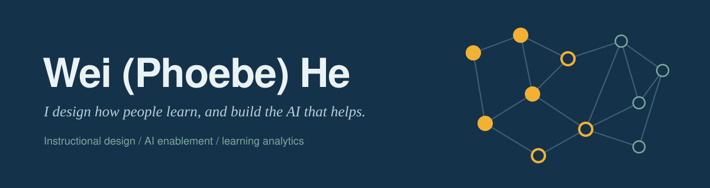

I've spent 7+ years designing training for people who do real, high-volume work: customer service agents, escalation specialists, warehouse teams, sales reps. Before that, I taught for 5 years. In the past year I started building the tools too. I've made four AI agents and an app for instructional designers, and I'm now building my own adaptive learning projects in Python.
My question is always the same: **did people actually perform better afterward?**

---

### What I'm building

**[AI Course Builder](https://github.com/yipenyezi/ai-course-builder)** — an AI-assisted instructional design workflow, with the designer kept in control

Paste in source material, get a structured storyboard, review and approve it, then generate an interactive HTML learning experience. The working prototype (Streamlit) already handles PDF/DOCX extraction, editable objectives and assessments, version history, and explicit ID approval before anything is built. Next on the roadmap: a needs-analysis step that asks *whether training is even the right fix* before designing a course, and configurable AI role-play for practice.

**Adaptive Learning Companion** — AI literacy practice that adapts to each learner *(in progress)*

An 11-skill competency map, an item bank tagged by objective and common misconception, content validation, and an event log that records every learner response. Mastery modeling and an AI tutor come next.

---

### What I've shipped at work

- **Four AI agents for course production**: a storyboarding agent and an HTML/simulation agent are live with real usage; a source-to-Markdown converter and a course QA agent are in internal testing.
- **Escalation specialist curriculum**: a controlled pilot showed the new program took **one week less** and still matched the old one on QA and customer satisfaction.

---

### What I believe

**A performance gap doesn't automatically call for a course.** Sometimes the fix is a tool, a process, or a job aid. Good design starts with diagnosis.

**AI drafts, designers decide.** The fastest workflows still keep a human accountable for what learners see.

**Measure against the original problem.** Completion rates are easy to report. Changed performance is what counts.

---

### Find me

📧 [pl5980614@gmail.com](mailto:pl5980614@gmail.com)
💼 [LinkedIn](https://www.linkedin.com/in/YOUR-HANDLE)

Open to roles in AI enablement, learning experience design, and sales enablement.
